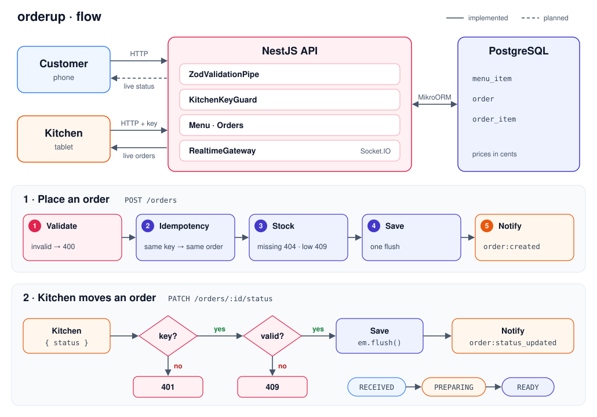

# OrderUp

An ordering system for a small diner. Customers build their order on their phone, and it shows up instantly on a kitchen screen. The kitchen updates the order's progress, and the customer follows along live, without refreshing the page.

## Tech stack

- **NestJS + TypeScript** for the API
- **MikroORM + PostgreSQL** to store the menu and orders
- **Zod** to validate request bodies, params and query strings
- **WebSockets** for real-time updates
- **Docker** to run everything together
- **React** for a simple customer screen and a kitchen screen

## Application flow



## User flow

1. The customer opens the menu and sees the available items, price and whether they're still in stock.
2. They pick items, adjust quantities and place the order. The system calculates the total and reserves the items in stock.
3. The order immediately appears on the kitchen screen as **Received**.
4. The kitchen marks the order as **Preparing** and then **Ready**. Each change shows up instantly on the customer's phone.
5. When the order is ready, the customer gets notified and picks it up.

## Key details

- **No overselling:** if there's only one burger left and two people order it at the same time, only one of them gets it.
- **No duplicate orders:** if the customer taps "Place order" twice, the system creates only one order.

## Routes

All prices are integers in cents (`2000` = R$ 20,00). IDs are UUIDs.

### Menu

| Method   | Route       | Description                                                                                    |
| -------- | ----------- | ---------------------------------------------------------------------------------------------- |
| `GET`    | `/menu`     | Lists every menu item                                                                          |
| `GET`    | `/menu/:id` | Returns one item · 404 when it doesn't exist                                                   |
| `POST`   | `/menu`     | Creates an item. Body: `{ "name", "price", "quantity" }` · 409 when the name is already in use |
| `PATCH`  | `/menu/:id` | Updates any of `name`, `price`, `quantity` (at least one) · `quantity: 0` marks it sold out    |
| `DELETE` | `/menu/:id` | Deletes an item · 404 when it doesn't exist                                                    |

### Orders

| Method  | Route                | Description                                                                                            |
| ------- | -------------------- | ------------------------------------------------------------------------------------------------------ |
| `POST`  | `/orders`            | Places an order. Body: `{ "customerName", "idempotencyKey", "items": [{ "menuItemId", "quantity" }] }` |
| `GET`   | `/orders`            | Lists orders, oldest first, with their items. Optional filter: `?status=RECEIVED,PREPARING`            |
| `GET`   | `/orders/:id`        | Returns one order · 404 when it doesn't exist                                                          |
| `PATCH` | `/orders/:id/status` | Moves the order forward. Body: `{ "status" }` · 409 for an invalid transition                          |

When placing an order:

- Sending the same `idempotencyKey` again returns the order that was already created instead of a new one.
- A missing menu item returns 404, and not enough stock returns 409.

The status only moves forward: `RECEIVED → PREPARING → READY`. Sending the current status again is a no-op (200).

Invalid bodies, params or query strings return 400 with the list of fields that failed.

### WebSocket events (planned)

| Event                  | Direction       | Room                     | When                                  |
| ---------------------- | --------------- | ------------------------ | ------------------------------------- |
| `kitchen:subscribe`    | client → server | joins `kitchen`          | the kitchen screen opens              |
| `order:subscribe`      | client → server | joins `order:{id}`       | the customer opens their order        |
| `order:created`        | server → client | `kitchen`                | after `POST /orders`                  |
| `order:status_updated` | server → client | `kitchen` + `order:{id}` | after `PATCH /orders/:id/status`      |
| `menu:stock_updated`   | server → client | everyone                 | after an order or a menu stock change |

## Frontend

The [`web/`](web) folder holds a small React app (Vite + TypeScript) with three tabs:

- **Cliente:** browse the menu, build a cart, place the order and follow its status.
- **Cozinha:** orders split into Recebido / Preparando / Pronto columns, with a button to move each one forward.
- **Cardápio (admin):** create, edit and delete menu items.

In dev, the app calls `/api/...` on its own origin and Vite proxies it to the API (`http://localhost:3000`, or `API_URL` if set), so the API doesn't need CORS yet. Until the WebSocket gateway exists, the customer and kitchen screens poll the API every 3 seconds.

> **Note:** the whole frontend ([`web/`](web)) was made with [Claude](https://claude.com/claude-code).

## Running locally

Requires Node.js 24, pnpm and Docker.

```bash
cp .env.example .env               # then adjust the values if you want
docker compose up -d               # PostgreSQL
pnpm install
pnpm exec mikro-orm migration:up   # creates the tables
pnpm exec mikro-orm seeder:run     # fills the menu with sample items
pnpm start:dev                     # API on http://localhost:3000
```

In another terminal, for the frontend:

```bash
cd web
pnpm install
pnpm dev                           # http://localhost:5173
```

Environment variables (see [`.env.example`](.env.example)):

- `POSTGRES_USER`, `POSTGRES_PASSWORD`, `POSTGRES_DB`, `POSTGRES_PORT`: used both by the Postgres container in [`compose.yaml`](compose.yaml) and by the API.
- `POSTGRES_HOST`: where the API finds Postgres (`localhost` when the API runs outside Docker).
- `PORT` (optional): the API's port, `3000` by default.

To try it out, list the menu and place an order with one of the item ids:

```bash
curl http://localhost:3000/menu
```

```bash
curl -X POST http://localhost:3000/orders -H "Content-Type: application/json" -d '{"customerName":"Ana","idempotencyKey":"0199f0a8-6c1e-7d3a-9b2f-4e5d6c7b8a90","items":[{"menuItemId":"<menu item id>","quantity":2}]}'
```

Other useful commands:

| Command                                | What it does                                  |
| -------------------------------------- | --------------------------------------------- |
| `pnpm exec mikro-orm migration:create` | Generates a migration from the entity changes |
| `pnpm exec mikro-orm migration:list`   | Shows which migrations already ran            |
| `pnpm lint`                            | Runs oxlint                                   |
| `pnpm test` / `pnpm test:e2e`          | Runs the unit / end-to-end tests (Vitest)     |

## Core features

- [x] Menu CRUD
- [x] Place an order with stock check and total calculated on the server
- [x] Idempotent order creation (`idempotencyKey`)
- [x] Stock is decremented and unit prices are frozen on the order items
- [x] List orders filtered by status
- [x] Status transitions validated on the server
- [ ] Lock menu rows while placing an order (`SELECT … FOR UPDATE`) so concurrent orders can't oversell
- [ ] WebSocket gateway with `kitchen` and per-order rooms
- [x] Customer, kitchen and menu admin screens (React, polling for now)
- [ ] API running in Docker alongside Postgres

## Safety checklist

- [x] Zod validation on bodies, params and query strings
- [x] Prices and totals calculated on the server, never trusted from the client
- [x] Unique order code and idempotency key in the database
- [x] Order status limited by a database check constraint
- [x] Duplicate menu item names rejected (409)
- [ ] Kitchen-only routes protected by a key (`KITCHEN_API_KEY`)
- [ ] Soft delete for menu items that already appear in orders
- [x] CORS configuration
- [ ] Rate limiting
